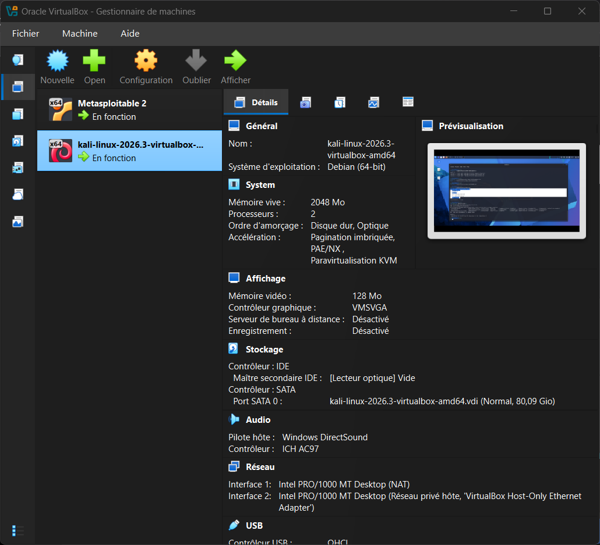
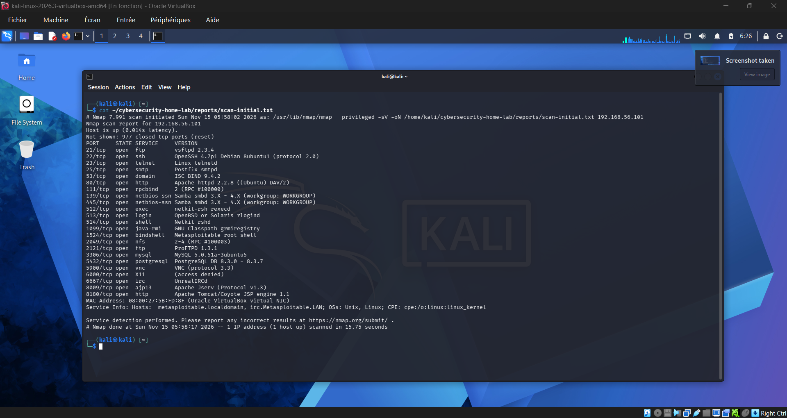
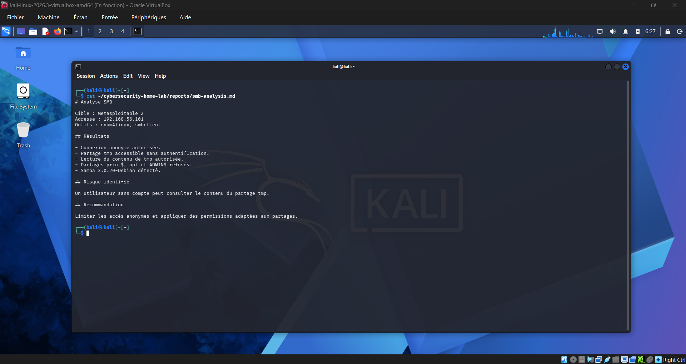

# Cybersecurity Home Lab


Laboratoire personnel de cybersécurité conçu pour apprendre les bases du pentest éthique, de la reconnaissance réseau et de l'audit de sécurité.

---

## Table of Contents

- Overview
- Lab Architecture
- Tools
- Installation
- Exercises
- Findings
- Project Structure
- Screenshots
- Ethics
- Author

---

## Overview

Ce projet utilise deux machines virtuelles pour construire un environnement de test isolé.

**Objectifs :**
- Apprendre la reconnaissance réseau.
- Identifier les ports et services.
- Analyser les services FTP et SMB.
- Repérer les mauvaises configurations.
- Rédiger des rapports d'audit.

## Lab Architecture

| Machine | Operating System | Role |
|---|---|---|
| Attacker | Kali Linux | Security testing |
| Target | Metasploitable 2 | Vulnerable machine |

**Network:** VirtualBox Host-only  
**Network range:** 192.168.56.0/24

## Tools

- Kali Linux
- Oracle VirtualBox
- Nmap
- enum4linux
- smbclient
- Wireshark
- Git

## Exercises

### 1. Network Discovery

- Identification de la machine cible.
- Vérification de la connectivité.
- Scan des ports avec Nmap.
- Identification des versions des services.

### 2. FTP Enumeration

- Vérification de l'accès anonyme.
- Inspection du répertoire racine.
- Documentation des permissions.

### 3. SMB Enumeration

- Identification des partages.
- Vérification de l'accès anonyme.
- Analyse du partage `tmp`.
- Vérification des permissions de lecture.

## Findings

| Service | Finding | Risk |
|---|---|---|
| FTP | Anonymous access enabled | Medium |
| SMB | Anonymous session allowed | Medium |
| SMB | Share `tmp` readable anonymously | Medium |
| SMB | Signing disabled | Medium |
| Bindshell | Root shell service detected on port 1524 | Critical |

Les niveaux de risque sont des estimations initiales. Ils nécessitent une validation technique complémentaire.

## Project Structure

```text
cybersecurity-home-lab/
├── README.md
├── documentation/
├── reports/
│   ├── rapport-final.md
│   ├── scan-initial.txt
│   └── smb-analysis.md
└── screenshots/
    ├── virtualbox-lab.png
    ├── nmap-scan.png
    └── smb-enumeration.png
```

## Screenshots

### VirtualBox Lab


### Nmap Scan


### SMB Enumeration


## Ethics

All tests were conducted on a personally controlled Metasploitable 2 virtual machine inside an isolated Host-only network.

Never scan systems without explicit authorization.

## Author

**BlueT0m**

GitHub: https://github.com/BlueT0m

---

Educational project for ethical hacking and penetration testing.
